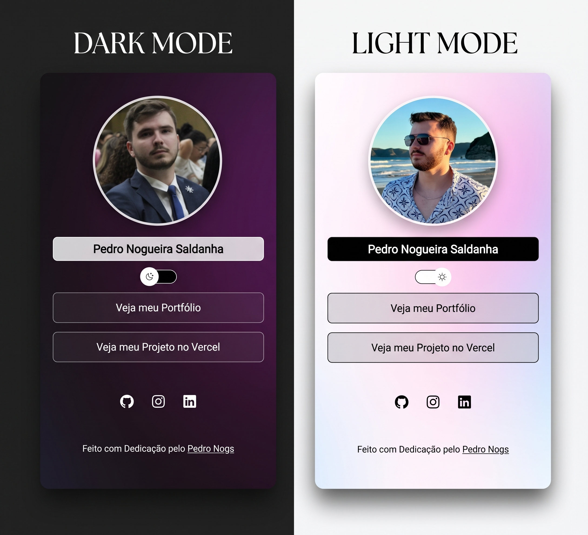

<h1 align="center"> Pedro Nogs - Agregador de Links 🇧🇷 </h1>

  

  Um projeto de agregação de links (estilo Linktree / DevLinks) com alternância de tema (Light / Dark mode), desenvolvido para reunir os links e redes sociais de Pedro Nogueira Saldanha.

## 🚀 Tecnologias

Esse projeto foi construído com as seguintes tecnologias:

- **HTML5**: Estruturação semântica da página
- **CSS3**: Estilização, variáveis de tema, efeitos de vidro (_glassmorphism_) e responsividade
- **JavaScript**: Lógica de alternância de temas (_Switch Mode_)
- **Ionicons**: Ícones vetoriais interativos (GitHub, Instagram e LinkedIn)

## 💻 Projeto

O projeto é uma página web responsiva que serve como um cartão de visitas digital para **Pedro Nogueira Saldanha**. Ele conta com:

- Botão funcional de **Switch Mode**, alternando de forma fluida entre os temas claro e escuro (com ajuste de fundo cinza escuro nas caixas, borda de 1px e destaque na caixa de perfil no modo claro).
- Links interativos personalizados (_Seguir a Dentadura_, _Os cara tao no teto_, _Ja expliquei_ e _Fica Aqui Rapaz_).
- Redes sociais centralizadas com ícones do **GitHub**, **Instagram** e **LinkedIn**.
- Layout adaptável para telas mobile e desktop.

## 🔖 Como usar

1. Faça o download ou clone o repositório.
2. Abra a pasta do projeto.
3. Dê um duplo clique no arquivo `index.html` para abrir no seu navegador.

---

  Feito com Patriotismo pelo <a href="https://www.instagram.com/vtx0123/" target="_blank">VituVTX</a>

